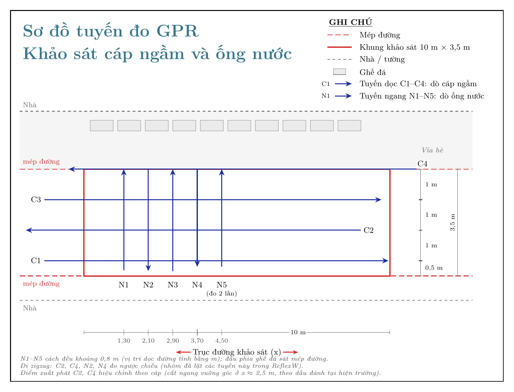

# 13 – Bản đồ ống nước và cáp ngầm (2D + 3D)

Gộp 10 file tuyến GPR trong `03_DuLieuHienTruong/Data - processed/` thành **một bản đồ chung** cho ống nước và cáp ngầm.
Vị trí tuyến lấy theo ảnh sơ đồ bố trí tuyến trong `Ảnh hiện trường/`: khung khảo sát 10 m × 3,5 m;
**C1–C4** là tuyến dọc (dò cáp), cách nhau 1 m, C1 cách mép trái 0,5 m, C4 trùng mép phải;
**N1–N5** là tuyến ngang (dò ống nước).




## 1. Kết quả

| Đối tượng | Đo bằng | Hướng | Độ sâu tới đỉnh | Vị trí |
|---|---|---|---|---|
| **Cáp ngầm** | P1 trên cả 4 tuyến dọc C1–C4 | cắt ngang, vuông góc với đường (90°), đúng như 3 dấu đánh tại hiện trường | 0,43–0,46 m (C2–C4), 0,64 m (C1) | x ≈ 2,5 m |
| **Ống nước** | tuyến ngang N2 (A1), N4, N5 (+ lần đo lặp N5) | chạy dọc đường (hiện trường: thẳng, song song mép đường; dữ liệu lệch 9°) | 0,43–0,59 m | cách mép đường phía ghế đá 0,67–1,09 m (hiện trường: khoảng 1 m), y ≈ 2,4–2,8 m |
| Dị thường khác | O1–O5, mỗi cái chỉ thấy trên 1 tuyến (C1, C2, C3) | chưa xác định | 0,40–0,90 m | chấm xám trên bản đồ |

**Nguồn điểm (cập nhật 18/10/2026):** vị trí, phân loại và độ sâu theo bản chú thích của nhóm `03_DuLieuHienTruong/New Data/GPR_chu_thich_duong_ong.pdf` (cột `ky_hieu`, `do_sau_nhom_m` trong `muc_tieu.csv`); điểm có `ky_hieu` được giữ đúng x, t của nhóm, không tinh chỉnh tự động. N5 và lần đo lặp N5 là điểm cũ (nhóm chưa chú thích N5).

- Hệ tọa độ: **x dọc đường**, **y ngang đường**. Gốc ở góc khung khảo sát, đầu có nhãn C1–C4, mép phía nhà.
- Đoạn nét liền là đoạn đã đo được; nét đứt là kéo dài thẳng ra tới mép vùng khảo sát, **chỉ là dự đoán**.
- **Độ sâu:** mô hình 2 lớp theo bản chú thích của nhóm: **0,12 m/ns trong lớp bê tông** (5 ns đầu, ≈ 0,30 m) và **0,10 m/ns trong đất**. Điểm nhóm đã ghi độ sâu thì dùng đúng số của nhóm. Mặt cắt trong cảnh 3D và khối 3D cũng đổi thời gian ra độ sâu theo mô hình này. v = 0,095 m/ns chỉ còn là vận tốc Kirchhoff migration trong ReflexW (dữ liệu `.00`). Muốn dùng một vận tốc cho mọi độ sâu: `--v 0.095` (hoặc `--v 0` để tự ước lượng bằng khớp hyperbol, trung vị ~0,12–0,14 m/ns).

## 2. Các file

| File | Vai trò |
|---|---|
| `ve_so_do_anh.py` → `ket_qua/SoDoTuyen_IMG_9558.jpg` | **sơ đồ bố trí tuyến vẽ trên ảnh IMG_9558**: C1–C4 vàng, N1–N5 xanh cách đều ~0,8 m (vị trí đọc từ `tuyen_do.csv`) |
| `SDT_Tai/` | **hình mặt cắt GPR theo mẫu trình bày** (cáp, ống nước, vùng tín hiệu quan tâm), xem `SDT_Tai/README.md` |
| `SoDoTuyen_GPR.tex` | **sơ đồ tuyến đo 2D bằng TikZ**, theo kiểu sơ đồ trong `metro.jpg`; toạ độ khai báo thành macro ở đầu file. Biên dịch bằng `pdflatex SoDoTuyen_GPR.tex` |
| `ket_qua/SoDoTuyen_GPR.pdf`, `.png` | bản đã biên dịch của sơ đồ tuyến |
| `ket_qua/BanDo_OngNuoc_Cap.png` | **bản đồ chung** (chữ tiếng Anh): bên trái là ảnh IMG_9558 có chồng ống/cáp, bên phải là mặt bằng theo mét có ghi độ sâu |
| `ket_qua/KetQua_IMG_9558.jpg` | ống nước và cáp vẽ lên ảnh IMG_9558, ghi độ sâu (chữ tiếng Anh, dùng cho slide 5 và 7) |
| `ket_qua/Canh3D_HienTruong.html` | **cảnh 3D tương tác (Three.js)**: mặt đất là ảnh IMG_9558 đã nắn thẳng, có ghế đá và tường nhà; máy GPR chạy theo các tuyến, mặt cắt radargram hiện dần, đất trong suốt dần để lộ ống và cáp. **Bấm vào ống nước, cáp hoặc điểm dị vật để xem thông số.** Code: `canh_3d.py` |
| `ket_qua/BanDo3D_OngNuoc_Cap.html` | **bản đồ 3D tương tác** (mở bằng trình duyệt, cần Internet để tải plotly.js) |
| `ket_qua/LatCat_DoSau.png` | 8 lát cắt ngang theo độ sâu (C-scan) |
| `ket_qua/muc_tieu_3d.csv` | tọa độ x, y, độ sâu của từng điểm ống/cáp |
| `ket_qua/muc_tieu_tu_dong.csv` | đỉnh hyperbol do script tự tìm, dùng để chọn thêm điểm vào `muc_tieu.csv` |
| `dung_ban_do_3d.py` | chương trình chính |
| `doc_reflexw.py` | đọc file ReflexW `.##R/.##T` |
| `tuyen_do.csv` | file ↔ tuyến (C1–C4 = LZZ…01–04, N1–N5 = LZZ…05–09, `N5_lap` = LZZ…10 là lần đo lặp N5) và vị trí đầu/cuối (m) |
| `muc_tieu.csv` | đỉnh hyperbol đã chọn; các dòng cùng `ten` được nối thành một ống/cáp; `loai` = `ong_nuoc` / `cap` / `khac` |
| `anh_so_do.csv` | 4 góc khung khảo sát trên ảnh, dùng để chồng bản đồ lên ảnh |
| `diem_rd7000.csv` | điểm RD7000 (x, y, độ sâu): điền vào thì sẽ tự hiện trên bản đồ 2D và 3D |
| `Ảnh hiện trường/` | ảnh sơ đồ bố trí tuyến, `metro.jpg` (mẫu sơ đồ), ảnh HEIC gốc |

Chạy lại sau khi sửa CSV:

```bash
cd 02_SoDoTuyen_BanDo
python3 dung_ban_do_3d.py              # mặc định: độ sâu mô hình 2 lớp, khối 3D từ dữ liệu migration kênh 700 MHz
python3 dung_ban_do_3d.py --v 0.095    # một vận tốc cho mọi độ sâu (--v 0: tự ước lượng bằng khớp hyperbol)
python3 dung_ban_do_3d.py --khoi goc   # khối 3D từ dữ liệu chưa migration
python3 dung_ban_do_3d.py --kenh 250MHz
cd SDT_Tai && python3 ve_mat_cat_gpr.py   # hình mặt cắt GPR theo mẫu (xem SDT_Tai/README.md)
```

Cần `numpy`, `scipy`, `matplotlib`.

## 3. Dữ liệu và cách dựng

- File ReflexW của máy IDS Detector Duo: `LZZ1…` là kênh **700 MHz**, `LZZ2…` là kênh **250 MHz**. Mỗi file 483 mẫu × 0,25 ns, khoảng vết 2,78 cm.
- Tuyến C đặt đúng theo kích thước ghi trên ảnh. N1–N5 cách đều khoảng 0,8 m (theo nhóm đo): x = 1,30 / 2,10 / 2,90 / 3,70 / 4,50 m.
- Mỗi điểm ống/cáp là đỉnh một hyperbol. Script tinh chỉnh vị trí đỉnh, đổi thời gian sang độ sâu theo z = v·t/2, rồi nối các điểm cùng tên thành đường thẳng.
- Khối 3D được dựng từ bao biên độ (Hilbert) của các tuyến **đã Kirchhoff migration** (`03_DuLieuHienTruong/SaoLuu/Data_backup_migration/`), không tính lần đo lặp. Nội suy tuyến tính giữa các tuyến (C cách nhau 1 m); ô cách vết đo quá 0,55 m bị bỏ trống. Vị trí đỉnh hyperbol vẫn lấy từ dữ liệu chưa migration.

## 4. ⚠️ Giả định cần kiểm tra

0. **Cáp cắt ngang vuông góc với đường ở x ≈ 2,5 m** (hiện trường xác nhận ngày 18/10/2026: người đo đánh dấu từng dị thường trên mặt đất, 3 dấu thẳng hàng vuông góc với mép đường).
   C1 và C3 (đo xuôi) cho đúng x = 2,50 m. Điểm xuất phát của hai tuyến đo ngược (C2, C4) vốn chưa đo, nên được hiệu chỉnh
   để P1 rơi vào cáp: C2 từ 9,64 thành 9,04 m, C4 từ 10,06 thành 10,86 m (xem `tuyen_do.csv`). Trên ảnh IMG_9558 có một vết cắt bê tông thẳng ngang đường ở x ≈ 2,53 m, khớp với vị trí này.
   Phương án trước đó (cáp chéo qua C2–C4, P1 trên C1 là vật riêng) đã bị loại.
1. **Đi zigzag: C2, C4, N2, N4 đo ngược chiều** (cập nhật 18/10/2026). Trong bản chú thích mới
   (`03_DuLieuHienTruong/New Data/GPR_chu_thich_duong_ong.pdf`), ảnh ReflexW của bốn tuyến này đã bị nhóm lật (XFlip).
   So ảnh với dữ liệu: tương quan khi lật là 0,61–0,67, khi không lật 0,34–0,51. Trước đây chỉ giả định C2, C4 ngược chiều.
2. **Đầu tuyến N phía ghế đá sát mép đường y = 3,5 m** (hiện trường xác nhận 18/10/2026). N1, N3, N5 đo từ phía nhà và kết thúc ở mép này; N2, N4 bắt đầu từ mép này.
   Đầu phía nhà vì vậy ở y = 3,5 − chiều dài tuyến, tức 0,16–0,30 m. Trước đây giả định cả 5 tuyến bắt đầu ở y ≈ −0,64 m theo ảnh phác, giả định đó đã bị loại.
   - Ống nước (hiện trường: thẳng, song song mép đường, cách mép phía ghế đá khoảng 1 m): A1 trên N2 cách mép 1,09 m, N4 0,78 m (điểm bổ sung), N5 0,72 m, N5 đo lặp 0,67 m.
   - N1, N3 không thấy hyperbol rõ ở chỗ này.

> **`muc_tieu.csv` đã đổi theo bản chú thích mới** (cột `ky_hieu`: P1 cáp trên C1–C4, A1 ống nước trên N2, O1–O5 dị thường).
> Các file kết quả bản đồ (`BanDo_OngNuoc_Cap.png`, `KetQua_IMG_9558.jpg`, `LatCat_DoSau.png`, 3D) **chưa chạy lại**, nên vẫn là kết quả cũ.
> Bảng ở mục 1 cũng là kết quả cũ. Chạy `python3 dung_ban_do_3d.py` để cập nhật. Lưu ý: script này đổi độ sâu bằng một vận tốc duy nhất (0,095),
> còn `SDT_Tai/` dùng mô hình 2 lớp của nhóm (bê tông 0,12 / đất 0,10 m/ns).
3. Khoảng cách 0,8 m giữa các tuyến N là giá trị gần đúng; vị trí N1 (x ≈ 1,3 m) ước lượng từ ảnh.
4. Tuyến C dài 10,9–11,4 m nên chạy quá khung 10 m. Đầu tuyến lấy tại x = −1,3 m, chỗ có nhãn C1–C4 trên ảnh.

Nếu một giả định sai, sửa `tuyen_do.csv` (và các macro ở đầu `SoDoTuyen_GPR.tex`) rồi chạy lại.

## 5. Hạn chế

- Chưa migration, nên vị trí ngang hơi nhòe. Độ sâu là tới **đỉnh** ống/cáp, chưa cộng bán kính.
- Ống và cáp được vẽ thẳng giữa các điểm đo. Ngoài đoạn đã đo, nét đứt chỉ là ngoại suy.
