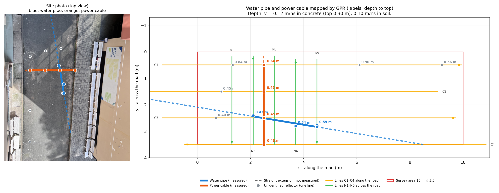

# Ứng dụng GPR khảo sát cáp ngầm và ống nước – Nhóm 1

Seminar môn **Các phương pháp Kiểm tra không phá hủy (NDT)**, Khoa Vật lý – Vật lý Kỹ thuật, Trường ĐH Khoa học Tự nhiên, ĐHQG-HCM.
Giảng viên hướng dẫn: **ThS. Nguyễn Văn Thuận**.

Nhóm dùng **Radar xuyên đất (GPR) IDS Detector Duo** (ăng-ten 250 MHz và 700 MHz) để tìm cáp điện và ống nước nằm dưới sân phía sau Tòa nhà I, cơ sở Nguyễn Văn Cừ, mà **không đào**. Khu khảo sát rộng 10 m × 3,5 m. Kho này chứa toàn bộ dữ liệu đo, code xử lý, hình, slide và báo cáo.

| Muốn xem | Mở file |
|---|---|
| Slide thuyết trình (tiếng Anh, có lời nói trong Notes) | [01_Slide/Seminar_GPR_EN_v3.pptx](01_Slide/Seminar_GPR_EN_v3.pptx) |
| Báo cáo (tiếng Việt, PDF) | [06_BaoCao/BaoCao_GPR_Nhom1.pdf](06_BaoCao/BaoCao_GPR_Nhom1.pdf) |
| Bản đồ ống nước và cáp | [02_SoDoTuyen_BanDo/ket_qua/BanDo_OngNuoc_Cap.png](02_SoDoTuyen_BanDo/ket_qua/BanDo_OngNuoc_Cap.png) |
| Cảnh 3D tương tác | [02_SoDoTuyen_BanDo/ket_qua/Canh3D_HienTruong.html](02_SoDoTuyen_BanDo/ket_qua/Canh3D_HienTruong.html) (tải về rồi mở bằng trình duyệt) |



## 1. Kết quả chính

| Đối tượng | Thấy trên tuyến | Hướng | Độ sâu tới đỉnh | Mức tin cậy |
|---|---|---|---|---|
| Cáp điện ngầm P1 | C1, C2, C3, C4 (4/4) | cắt ngang đường, vuông góc, tại x = 2,5 m | 0,43–0,65 m | cao |
| Ống nước A1 | N2, N4, N5 (3/5) | chạy dọc đường, cách mép phía ghế đá khoảng 1 m | 0,43–0,59 m | trung bình |
| Dị thường O1–O5 | mỗi cái chỉ thấy trên 1 tuyến | chưa xác định | 0,26–0,89 m | thấp |

**Hạn chế:**
- Độ sâu phụ thuộc vận tốc sóng. Mô hình 2 lớp (0,12 m/ns trong bê tông, 0,10 m/ns trong đất) và vận tốc migration 0,095 m/ns cho độ sâu lệch nhau khoảng 20 %.
- Vị trí tuyến đo được đặt bằng thước, không dùng GPS.
- **Chưa xác định được đường kính ống.** Hyperbol của ống không hội tụ sau migration. Kích thước 31 × 14 cm thấy được trên cáp chỉ là kích thước biểu kiến, bị giới hạn bởi độ phân giải.

## 2. Cách nhóm thực hiện

1. **Khảo sát mặt bằng.** Xem mặt sân (lớp bê tông trên nền đất), tìm dấu hiệu hạ tầng như nắp hố ga và vạch sơn đánh dấu cáp. Chọn hệ trục x dọc đường, y ngang đường.
2. **Lập lưới tuyến zigzag.**
   - 4 tuyến dọc **C1–C4** dài 10 m, cách nhau 1 m, dùng để cắt ngang cáp.
   - 5 tuyến ngang **N1–N5** dài 3,5 m, dùng để cắt ngang ống nước.
   - Mục tiêu cho hyperbol rõ nhất khi tuyến đo cắt vuông góc với nó.
3. **Đo.** Đẩy xe GPR đều theo từng tuyến, xem radargram trên laptop ngay tại chỗ. Một vết đo cách nhau 2,78 cm. Có đo lặp N5 để kiểm tra độ lặp lại.
4. **Xử lý trên ReflexW.** Chuỗi xử lý gồm:
   - dịch mốc thời gian −7,3 ns;
   - khử DC-shift;
   - dewow 4 ns;
   - xóa nhiễu nền;
   - gain function;
   - lọc trung bình 2D;
   - dịch chuyển Kirchhoff (v = 0,095 m/ns).

   Các tuyến đo ngược chiều (C2, C4, N2, N4) được lật lại (XFlip) trước khi xử lý.
5. **Giải đoán.** Tìm đỉnh hyperbol trên từng tuyến, rồi đổi thời gian ra độ sâu theo mô hình 2 lớp. Nối các đỉnh trên những tuyến song song để được đường đi của cáp và ống.
6. **Lập bản đồ.** Script Python vẽ bản đồ 2D, các lát cắt theo độ sâu và cảnh 3D.

## 3. Cấu trúc thư mục

| Thư mục | Nội dung |
|---|---|
| [00_QuanLy/](00_QuanLy/) | Yêu cầu seminar của môn, kế hoạch phân công, câu hỏi hỏi thầy |
| [01_Slide/](01_Slide/) | Slide `Seminar_GPR_EN_v3.pptx`, kịch bản nói (EN/VI), giải thích thuật ngữ. Ngoài ra có `HinhAnh/` (mọi hình trên slide), `_build/` (code dựng slide) và `LuuTru/` (các bản slide cũ) |
| [02_SoDoTuyen_BanDo/](02_SoDoTuyen_BanDo/) | Sơ đồ tuyến (TikZ), file vị trí tuyến và mục tiêu (`tuyen_do.csv`, `muc_tieu.csv`), code dựng bản đồ 2D/3D, kết quả trong `ket_qua/`, ảnh hiện trường |
| [03_DuLieuHienTruong/](03_DuLieuHienTruong/) | Dữ liệu GPR: `Data - processed/` (file ReflexW đã xử lý), `New Data/` (kênh 250 MHz và bản chú thích của nhóm), `ChuThich_VeLai/`, `BangKetQua/`, `SaoLuu/` |
| [04_XuLy_MoPhong/](04_XuLy_MoPhong/) | Script xử lý B-scan, vẽ hình lý thuyết, mô hình hyperbol, file mô phỏng gprMax |
| [05_TaiLieu/](05_TaiLieu/) | Quy trình khảo sát, thiết bị, tóm tắt cách dùng ReflexW, danh mục tài liệu tham khảo (`references.bib`) |
| [06_BaoCao/](06_BaoCao/) | Báo cáo hoàn chỉnh (PDF) |
| [99_LuuTru_BaoCao/](99_LuuTru_BaoCao/) | Bản thảo cũ của báo cáo và bản nháp của từng thành viên |

Dữ liệu GPR: các file `LZZ1….##` là kênh 700 MHz, `LZZ2….##` là kênh 250 MHz. Số cuối của tên file cho biết tuyến: `01–04` = C1–C4, `05–09` = N1–N5, `10` = đo lặp N5. Đuôi `.##R` là header, `.##T` là dữ liệu.

## 4. Hướng dẫn sử dụng

### 4.1. Chỉ xem, không cần cài gì

- Bấm vào file PDF, PNG hoặc `.md` ngay trên GitHub là xem được.
- Slide `.pptx` thì bấm **Download raw file**, rồi mở bằng PowerPoint, Keynote hoặc Google Slides.
- File `.html` (cảnh 3D, bản đồ 3D) thì tải về rồi mở bằng Chrome, Edge hoặc Safari. Cần có Internet để tải thư viện 3D.

### 4.2. Tải cả kho về máy

- **Không dùng git:** bấm nút xanh **Code → Download ZIP**, rồi giải nén.
- **Dùng git:**

  ```bash
  git clone https://github.com/LongDallas/NDT-GPR-Nhom1.git
  cd NDT-GPR-Nhom1
  ```

Kho nặng khoảng 280 MB, vì có slide, báo cáo và ảnh hiện trường.

### 4.3. Xem dữ liệu GPR bằng ReflexW

1. Mở ReflexW (Sandmeier), tạo một project mới.
2. Chép các file trong `03_DuLieuHienTruong/Data - processed/` vào thư mục `ROHDATA` hoặc `PROCDATA` của project.
3. Mở từng tuyến bằng **2D-dataanalysis**. Bước xử lý và tham số xem ở mục 3.2 của báo cáo và trong `05_TaiLieu/SachReflexW/03_UngDung_ReflexW_DeTai.md`.

### 4.4. Chạy lại bản đồ 2D/3D bằng Python

Cần Python 3.10 trở lên:

```bash
pip install numpy scipy matplotlib pillow
cd 02_SoDoTuyen_BanDo
python3 dung_ban_do_3d.py                # đọc dữ liệu, vẽ bản đồ, lát cắt, cảnh 3D vào ket_qua/
python3 dung_ban_do_3d.py --v 0.095      # dùng một vận tốc cho mọi độ sâu
python3 ve_so_do_anh.py                  # vẽ sơ đồ tuyến lên ảnh hiện trường
cd SDT_Tai && python3 ve_mat_cat_gpr.py --en   # hình mặt cắt GPR (chữ tiếng Anh)
```

- Muốn thêm hoặc sửa một đỉnh hyperbol thì sửa `muc_tieu.csv`, rồi chạy lại `dung_ban_do_3d.py`.
- Hình mới tự chép sang `01_Slide/HinhAnh/`.
- Chi tiết từng tham số xem [02_SoDoTuyen_BanDo/README.md](02_SoDoTuyen_BanDo/README.md).

Các script trong `04_XuLy_MoPhong/` vẽ hình lý thuyết và hình trước/sau xử lý. Chạy bằng `python3 <tên script>.py`. File `gprMax/cap_ngam_2D.in` chạy được bằng [gprMax](https://www.gprmax.com/): `python -m gprMax cap_ngam_2D.in`.

### 4.5. Dựng lại slide

Cần Node.js 18 trở lên:

```bash
cd 01_Slide/_build
npm install                                   # cài pptxgenjs, playwright-core
node tao_seminar_v3.js ../Seminar_GPR_EN_v3.pptx
python3 them_hieu_ung.py ../Seminar_GPR_EN_v3.pptx   # hiệu ứng slide 1, video tự chạy
```

- Nội dung slide nằm trong `tao_seminar_v3.js`. Sửa chữ ở đó rồi chạy lại hai lệnh trên.
- Công thức trên slide là ảnh, vẽ bằng `ve_cong_thuc.py`.
- Mã QR dẫn tới kho này nằm ở `HinhAnh/QR_GitHub.png`.

## 5. Ghi chú

- Kho **không kèm** sách hướng dẫn ReflexW gốc và bản dịch đầy đủ của nó, vì đó là tài liệu có bản quyền của Sandmeier. Bản tóm tắt và phần áp dụng do nhóm viết vẫn có trong `05_TaiLieu/SachReflexW/`.
- Ảnh `.HEIC` là ảnh gốc chụp bằng iPhone. Máy Windows cần cài HEIF Image Extensions để xem được.
- Có thắc mắc hoặc thấy lỗi thì mở **Issue** trên GitHub.

## 6. Thành viên Nhóm 1

| Họ và tên | Công việc |
|---|---|
| Nguyễn Đăng Khoa | Xử lý dữ liệu |
| Đỗ Thành Trung | Xử lý dữ liệu |
| Nguyễn Đăng Quang | Xử lý dữ liệu |
| Hồ Ngọc Bảo Châu | Thiết kế slide |
| Lê Quốc Long | Thực nghiệm hiện trường, thiết kế slide |
| Dương Quốc Tài | Thực nghiệm hiện trường, tổng hợp và viết báo cáo |

Nhóm cảm ơn ThS. Nguyễn Văn Thuận và Bộ môn Vật lý Địa cầu đã hướng dẫn và cho mượn thiết bị.
